  

 

## 👨‍💻 Sobre mim

👋 Meu nome é **Vinicius Rocha Pacheco**, tenho 29 anos e sou do Rio de Janeiro.

🎓 Estou cursando **Análise e Desenvolvimento de Sistemas** na Universidade Veiga de Almeida (UVA).

💻 Complemento minha formação estudando **Java** e **desenvolvimento Back-End**, com o objetivo de atuar como desenvolvedor **back-end**.

📚 Meus estudos têm foco em Java, lógica de programação, APIs, banco de dados e desenvolvimento, sempre buscando aplicar boas práticas de programação.

🌱 No momento estou aprendendo **Spring Boot** para construir APIs REST e **PostgreSQL** como banco de dados.

🧩 Nos meus projetos já pratiquei **POO**, **padrão DAO**, **Generics** e **separação em camadas**.

🚀 Estou em busca da minha primeira oportunidade na área de tecnologia, onde possa aplicar meus conhecimentos, contribuir com projetos e continuar evoluindo como desenvolvedor.

 

## 🛠 Tecnologias

**Linguagens**
 

  

**Frameworks e ferramentas**
 

 

## 📊 Atividade no GitHub

  

  

 

### Nível nas principais skills

<!-- Para atualizar: troque o número antes de %25 (ex.: 40%25 = 40%) -->

 

## 🐍 Contribuições em movimento

<picture>
  <source media="(prefers-color-scheme: dark)" srcset="https://raw.githubusercontent.com/vinnyrocha-dev/vinnyrocha-dev/output/github-snake-dark.svg"/>
  <source media="(prefers-color-scheme: light)" srcset="https://raw.githubusercontent.com/vinnyrocha-dev/vinnyrocha-dev/output/github-snake.svg"/>
  
</picture>

 

## 🤝 Conecte-se comigo

 

